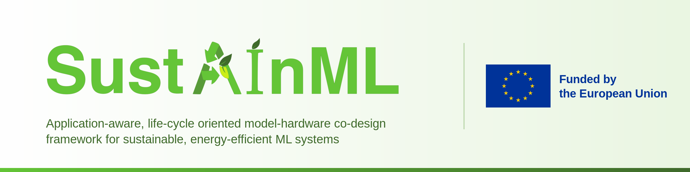

  

**SustainML** is a Horizon Europe research project that develops an interactive design framework, together with the models, methods and tools behind it, to make machine learning systems more energy efficient across their whole life cycle.

AI has become a significant contributor to the carbon footprint of the European economy. Most of the tools that drive its adoption put performance and functionality first and pay little attention to energy use. SustainML addresses this at every stage of an ML application: design and exploration, final training of the production system, and inference or continuous re-training during deployment. The framework optimizes ML solutions for the target application across levels, from the hardware up to the model architecture. Rather than relying on black-box, fully automated optimization, it puts the developer in the loop through human-centric, transparent design and reusable functional knowledge cores, so that AI developers of all experience levels can build greener ML systems.

---

SustainML is funded by the European Union under the Horizon Europe programme, Grant Agreement No. 101070408. Views and opinions expressed are those of the author(s) only and do not necessarily reflect those of the European Union or the European Commission. Neither the European Union nor the granting authority can be held responsible for them.
